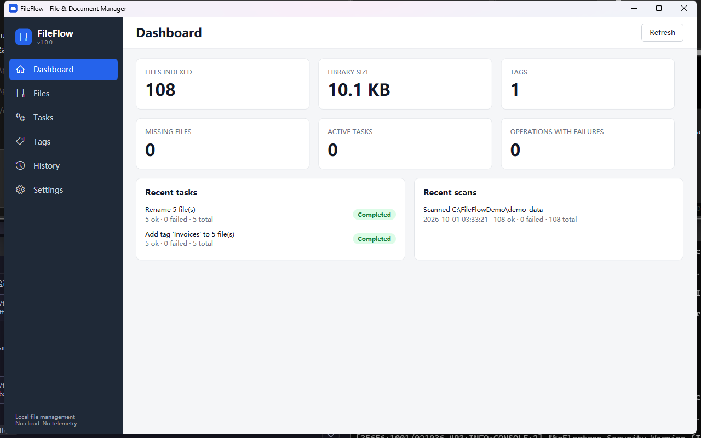
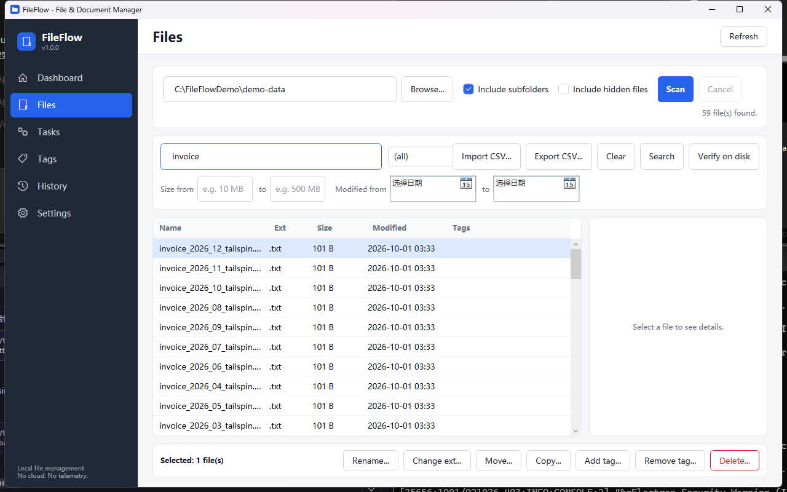
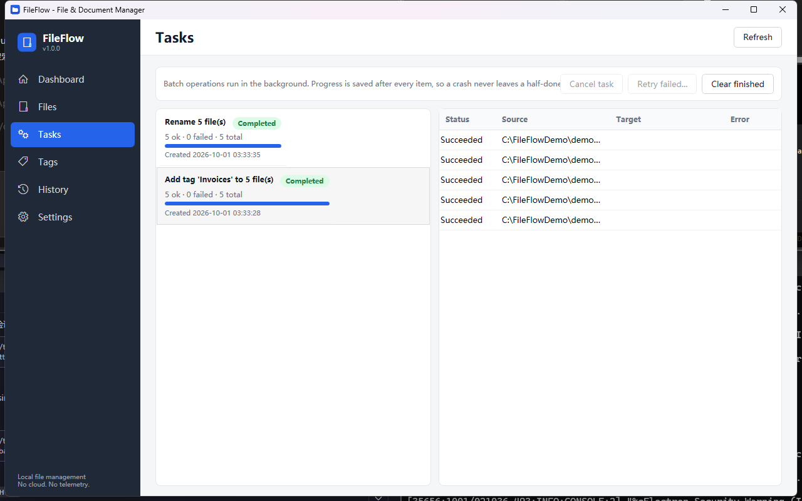
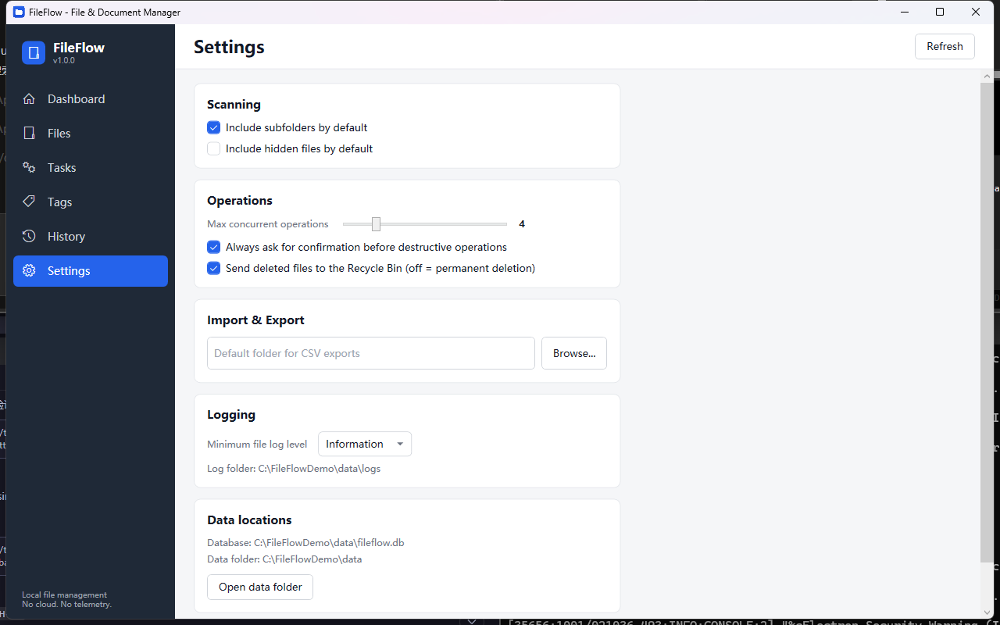

# FileFlow

[](https://github.com/taozhihaoo/file-flow/actions/workflows/ci.yml)
[](LICENSE)
[](#requirements)
[](https://dotnet.microsoft.com/download/dotnet/8.0)

**English** · [简体中文](README.zh-CN.md)

A local file and document management utility for Windows: scan folders into a searchable library,
organize files with tags, and run validated batch operations (rename, move, copy, delete, extension
changes) through a background task queue.

Built with C# / .NET 8 / WPF (MVVM) and SQLite. A small, complete desktop application rather than a
demo UI: no cloud, no telemetry, no network access.

## Screenshots

| | |
|---|---|
|  |  |
|  |  |

*Captured from the running application in English. The Chinese screenshots live in
[`docs/screenshots/zh`](docs/screenshots/zh) — see [Regenerating screenshots](#regenerating-screenshots).*

## Features

- **File Scanner** — pick one or more folders and scan them recursively (or not), with live progress,
  processed counts, error counts and cancellation. Unreadable files or folders are reported without
  aborting the scan.
- **File Library** — every scanned file is stored in a local SQLite database (path, name, extension,
  size, created/modified/scanned timestamps). `full_path` is unique. Deleted files are marked
  `is_missing`, never silently removed; a scan or the *Verify on disk* action reconciles the library
  with reality.
- **Search & Filters** — keyword search over name/path (e.g. `invoice`, `.pdf`), plus filters for
  extension, size range (`10 MB` style input), modified-date range, tags and missing-only. Filter
  changes are debounced, so typing does not fire one query per keystroke.
- **Tags** — create, rename and delete tags (unique, case-insensitive names) and apply/remove them to
  file selections. Files can carry any number of tags and tag filtering is part of search.
- **Batch Operations with Preview** — rename, move, copy, delete to Recycle Bin (or permanently),
  change extension, add/remove tag. Every high-risk operation first shows a full **Before → After
  preview** with per-file validation (invalid names, duplicate targets, collisions with existing
  files). Conflicting files are skipped and reported.
- **Rename Rules** — prefix, suffix, find/replace (case-insensitive) and zero-padded sequential
  numbering, freely combined. The preview updates live as rules change.
- **Task Queue** — batch operations run as background tasks: one task at a time, items inside a task
  with bounded parallelism (configurable 1–16, default 4). Tasks are cancellable, progress is
  persisted after every item, and failed items can be retried as a new task. Task states: `Queued`,
  `Running`, `Completed`, `CompletedWithErrors`, `Failed`, `Cancelled`, `Interrupted`.
- **Operation History** — every scan, task, import and export writes a history entry. Rename/move
  tasks store an old→new path map in their metadata — the data foundation for a future Undo feature
  (Undo itself is *not* implemented yet).
- **Import / Export (CSV)** — export any search result to CSV
  (`file_name, full_path, extension, size_bytes, modified_at, tags`, UTF-8 with BOM). Import
  validates headers, skips and reports invalid rows with their row numbers, and avoids duplicates
  both inside the file and against the library. Metadata only — file contents are never read or
  uploaded.
- **Settings** — scan defaults, default export folder, max concurrent operations, destructive-action
  confirmation, Recycle Bin vs. permanent delete, log level, **interface language**. Stored in SQLite
  under `%LOCALAPPDATA%\FileFlow`; reset-to-defaults included.
- **Dashboard** — indexed file count, library size, tag count, missing files, active tasks,
  operations with failures, recent tasks and recent scans.
- **Bilingual UI** — English and Simplified Chinese, switchable from Settings and applied
  immediately (no restart). English is the default.
- **Screenshot mode** — `--capture <folder>` renders every page to PNG, used to keep the
  documentation screenshots in both languages up to date.
- **Logging** — `Microsoft.Extensions.Logging` with a custom rolling file logger
  (`%LOCALAPPDATA%\FileFlow\logs\fileflow-yyyyMMdd.log`), configurable level, task context in messages.

## Architecture

Clean layering with dependency inversion — dependencies point inward:

```
FileFlow.App (WPF, MVVM)
    Views + ViewModels (CommunityToolkit.Mvvm), localization service, dialogs
        |
FileFlow.Core  (no WPF, no SQLite, no System.IO file access)
    domain models, interfaces, business rules
    rename/move planners, file-name & path validation, scanner, state machine, CSV, string catalog
        |
FileFlow.Infrastructure
    SQLite (Microsoft.Data.Sqlite, raw parameterized SQL)
    repositories, schema migrations
    WindowsFileSystem (IFileSystem), Recycle Bin shell API
    file service, task queue service, import/export, settings, file logging
```

Rules enforced in the codebase:

- Views never touch SQLite; ViewModels never call file APIs directly — they use Core interfaces.
- Core has **no** dependency on WPF or SQLite and no `System.IO.File` usage; all real file operations
  live behind `IFileSystem` in Infrastructure.
- All SQL is parameterized (no string concatenation); data access is concentrated in the repository
  classes.
- Business logic reads configuration only through `ISettingsService` — never from environment
  variables.
- Errors are classified (`ErrorKind`: FileAccess, FileNotFound, PathValidation, OperationConflict,
  Persistence, Cancelled) and translated to user-readable messages in the UI layer; technical details
  go to the log.
- Every user-visible string lives in one catalogue in Core (`AppStrings`), so translations are
  unit-tested for key parity and placeholder consistency.

### Technology Stack

| Component | Choice | Why |
|---|---|---|
| Runtime | .NET 8 (LTS) | LTS target |
| UI | WPF + XAML, MVVM via CommunityToolkit.Mvvm | Windows desktop, source-generated commands/observables |
| DI | Microsoft.Extensions.DependencyInjection | composition root wiring |
| Logging | Microsoft.Extensions.Logging + custom file provider | no second logging framework |
| Database | Microsoft.Data.Sqlite | local, serverless, no EF Core — hand-written parameterized SQL |
| Tests | xUnit | fast, deterministic |

Direct NuGet dependencies: `CommunityToolkit.Mvvm`, `Microsoft.Extensions.DependencyInjection`,
`Microsoft.Extensions.Logging`, `Microsoft.Data.Sqlite` (+ `Microsoft.Extensions.Logging.Abstractions`
in Infrastructure). Nothing else.

## Requirements

- Windows 10 (1809+) or Windows 11, x64
- [.NET 8 Desktop Runtime](https://dotnet.microsoft.com/download/dotnet/8.0) (for the
  framework-dependent build; the self-contained build needs nothing)
- To build from source: .NET 8 SDK

## Installation

Download or build a release and run `FileFlow.App.exe`. The first start creates
`%LOCALAPPDATA%\FileFlow\` with the database and log folder — no installer, no registry writes, no
admin rights needed.

For a portable run (data directory next to the exe instead of AppData):

```
FileFlow.App.exe --datadir D:\FileFlowData
```

### Command line

| Argument | Purpose |
|---|---|
| `--datadir <path>` | Use a portable data directory instead of `%LOCALAPPDATA%\FileFlow` |
| `--lang <en\|zh-CN>` | Override the interface language for this run |
| `--capture <folder>` | Render every page to PNG in `<folder>` and exit |
| `--capture-scan <folder>` | Index a folder first (used together with `--capture`) |

## Running from Source

```
dotnet build
dotnet test
dotnet run --project src/FileFlow.App
```

## Demo Data

Generate ~100 fictional files (invoices, documents, reports, images, projects, archive — no real
personal data):

```
powershell -ExecutionPolicy Bypass -File scripts\create-demo-data.ps1
```

Then in FileFlow: **Files → Browse → select `demo-data` → Scan**.

## Regenerating screenshots

The application can render its own pages, which keeps the documentation images in sync with the UI and
produces both language variants from the same build:

```
# English
FileFlow.App.exe --lang en --capture-scan demo-data --capture docs\screenshots\en

# Chinese
FileFlow.App.exe --lang zh-CN --capture-scan demo-data --capture docs\screenshots\zh
```

Each run writes `dashboard.png`, `files.png`, `tasks.png`, `tags.png`, `history.png` and
`settings.png`. The CI workflow exposes the same two commands as a manual job
(*Actions → CI → Run workflow*) and uploads the result as the `screenshots` artifact.

## Localization

- Every string lives in `src/FileFlow.Core/Localization/AppStrings.cs` (English + Simplified Chinese).
- XAML binds through `{loc:T Key}`; code uses `Loc.Instance["Key"]` / `Loc.Instance.F("Key", args)`.
- Switching the language in **Settings → Appearance** re-renders every label immediately and is
  persisted in the settings table.
- `LocalizationTests` fails the build if the two languages drift apart (missing keys, empty values,
  incompatible `{0}` placeholders).

To add a language: add a dictionary in `AppStrings`, register the code in `AppLanguages.All`, and
extend `DisplayNames.Language`.

## Database

SQLite at `%LOCALAPPDATA%\FileFlow\fileflow.db` (WAL mode, foreign keys on). The schema is
created/updated by a small, idempotent, version-table-based migrator on every start.

| Table | Purpose |
|---|---|
| `files` | indexed files, `full_path` unique, `is_missing` flag |
| `tags` | unique (case-insensitive) tag names |
| `file_tags` | many-to-many, cascading deletes |
| `tasks` | queue entries: type, status, counters, timestamps, JSON metadata |
| `task_items` | per-item state, source/target path, error kind/message |
| `operation_history` | history entries per operation/scan |
| `settings` | key/value application settings (JSON blob) |
| `schema_version` | applied migration versions |

Indexes on file name, extension, modified date and missing flag; searches run through these where
possible.

## File Operations

- Rename/move/copy/delete run per item: validate → execute on disk → update database row → record
  progress. A failure on a single item never aborts the batch; the task ends as `Completed`,
  `CompletedWithErrors` (mixed) or `Failed` (nothing succeeded).
- Per-path locking prevents rename/move/delete/copy from racing on the same file (case-insensitive
  keys).
- **Cross filesystem/database atomicity is intentionally NOT provided** — Windows file systems and
  SQLite cannot share a transaction. If a file operation succeeds but the database update fails, the
  item is recorded as failed with a recovery hint and a rescan reconciles the library. This is
  documented behaviour, not a hidden best effort.
- Delete uses the Windows Recycle Bin (shell API, `FOF_ALLOWUNDO`) by default; permanent delete is
  available in Settings. There is no secure erase, no deletion bypass and no permission bypass —
  standard Windows ACLs apply as-is.
- Critical system directories (`C:\Windows`, `C:\Program Files*`, `C:\ProgramData`) trigger an extra
  warning before batch operations.

## Task Queue

One task runs at a time; items within a task run with bounded parallelism (Settings: 1–16, default 4)
via `Parallel.ForEachAsync`. Every item completion is persisted immediately (task counters + item
row), so a crash never leaves a silent half-done batch: the next start marks tasks that were `Running`
as `Interrupted`, and tasks still `Queued` resume automatically. *Retry failed* re-enqueues only the
failed items of a task as a new task. Pause is not implemented (cancellation is).

## Search & Tags

Keyword search matches file name and path (`LIKE` with escaped wildcards); extension/size/date/tag
filters combine with it. Tags are unique case-insensitive names linked many-to-many through
`file_tags` with cascading deletes.

## Import / Export

Export writes the current search results as RFC-4180 CSV. Import validates headers, skips invalid rows
(reporting the row number and reason), de-duplicates within the file and against the library, and
creates/links tags found in the `tags` column. Existing records are updated with the imported size and
modification date; the creation timestamp is kept because a CSV export does not carry it.

## Configuration

All settings live in the `settings` table and are loaded once at startup into `ISettingsService`;
changes are validated, clamped and applied immediately (e.g. log level, interface language). Defaults
are used for anything unset.

## Testing

238 automated xUnit tests (all deterministic — in-memory fake file systems, real `TempDirectory`
fixtures and throwaway SQLite databases; the user's real file system and library are never touched):

- **Core (137)** — file-name/path validation, protected-path detection, rename/move/copy planning
  (rules, duplicates, collisions, case-only renames), task state machine transitions, CSV
  parser/writer round-trips, byte formatting, scanner behaviour (recursion, hidden files,
  cancellation, progress, error isolation) against a fake file system, and translation catalogue
  consistency (key parity, empty values, placeholder compatibility).
- **Infrastructure (101)** — schema migrations (idempotency, data preservation, FK cascades), all
  repositories (CRUD, search filters, paging, tag relations, missing-marking), Windows file system
  mappings (locked/read-only/missing files), file service (validation, case-only rename, concurrency
  protection), end-to-end task-queue tests against real SQLite + temp files (rename/move/copy/delete/
  tag tasks, partial failure → `CompletedWithErrors`, deterministic cancellation, retry-failed, crash
  recovery → `Interrupted`, queued-task resume, undo metadata, parallel tag creation race), CSV
  import/export (round-trip, invalid rows with row numbers, duplicate handling, header validation),
  settings round-trip/validation, keyed-lock mutual exclusion.

```
dotnet test -c Release
```

## Building for Windows

```
# framework-dependent (requires .NET 8 Desktop Runtime on the target machine)
dotnet publish src/FileFlow.App -c Release -r win-x64 --self-contained false

# self-contained (no runtime needed)
dotnet publish src/FileFlow.App -c Release -r win-x64 --self-contained true
```

Both produce `FileFlow.App.exe`.

## CI

`.github/workflows/ci.yml` runs on `windows-latest` for every push and pull request to `main`:

1. restore (with NuGet caching) → Release build (`TreatWarningsAsErrors`) → `dotnet test` with TRX
   output and code-coverage collection;
2. test results and a `win-x64` publish artifact are uploaded;
3. a manual job (`workflow_dispatch`) regenerates the English and Chinese screenshots and uploads them
   as an artifact.

## Security & Safety

See [SECURITY.md](SECURITY.md) for the threat model and how to report a vulnerability. In short:

- FileFlow operates on the **local filesystem and does not upload file contents** — no cloud, no
  telemetry, no external API calls, no network access at all.
- Logs contain paths and task counters, never file contents, secrets or credentials.
- Destructive operations require an explicit preview + confirmation; protected system directories add
  an extra warning.
- No `Environment.GetEnvironmentVariable` reads in business logic; configuration is centralized.
- Nothing under `bin/`, `obj/`, `.vs/`, `*.db`, `logs/`, `demo-data/` or user data directories is
  committed (see `.gitignore`).

## Limitations

- Windows-only (WPF, Recycle Bin shell API).
- Single-user, local library only: no cloud sync, no authentication, no multi-user, no network
  storage, no watching for external changes (rescan to refresh).
- No full-text content indexing and no content hashing during normal scans (the schema has a nullable
  `content_hash` column reserved for a future optional feature).
- Cross filesystem/database transactions are not possible; consistency is reconciled via rescan (see
  File Operations).
- Undo is prepared (path maps stored) but not implemented.
- Recycle-Bin deletion is not exercised by automated tests (it would touch the real Recycle Bin);
  permanent-delete paths are covered.
- Non-ASCII/long-path edge cases rely on standard .NET/Windows behaviour (long-path aware manifest is
  set); UNC/network paths are rejected by validation.

## Project Structure

```
FileFlow.sln
src/
  FileFlow.Core/                 domain models, interfaces, planners, validation, scanner, CSV,
                                 state machine, string catalogue
  FileFlow.Infrastructure/       SQLite (migrations, repositories), WindowsFileSystem, RecycleBin,
                                 file service, task queue, import/export, settings, file logging
  FileFlow.App/                  WPF: views, view models, dialogs, DI composition, theme,
                                 localization, screenshot service
tests/
  FileFlow.Core.Tests/           validators, planners, state machine, CSV, scanner, localization
  FileFlow.Infrastructure.Tests/ DB, repositories, file service, task queue, import/export, settings
scripts/
  create-demo-data.ps1           generates ~100 fictional demo files
docs/screenshots/en|zh/          application screenshots per language
```

## License

[MIT](LICENSE)
